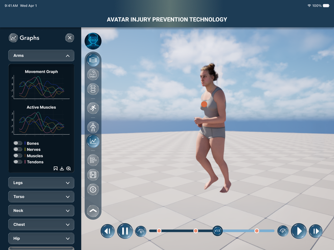
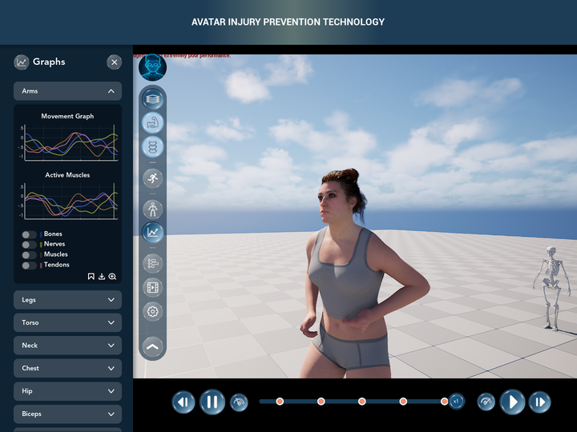

# MetaHumanTest — New UI (Figma "FINAL FESTIVAL")

The **FINAL FESTIVAL redesign of the IHPC UI** (Avatar Injury Prevention Technology, LSU DMAE) inside the
*MetaHumanTest* Unreal Engine 5.8 project. The drop-down nav bar is replaced by **tabs in a side bar**, and each tab
opens a **side panel** on the left. The redesign also adds an assistant (**BOT**) chat window and a **reset-view**
button.

| Figma (frame 21) | Unreal (Play-In-Editor) |
|---|---|
|  |  |

**Start here:** [`README/08_Final_Festival_Redesign.md`](../README/08_Final_Festival_Redesign.md) has a 30-second
tour, every Figma frame next to Unreal, the widget trees, how to change things, what was tested and what is still open.
Every step, with its commit: [`README/CHANGELOG.md`](../README/CHANGELOG.md).

This repo holds **only the UI work**: the C++ in `Source/MetaHumanTest/*/IHPC_UI`, the Widget Blueprints and
textures in `Content/UserInterface/IHPC`, `BP_PlayerController` / `BP_SpeedSlider`, the Figma source art, the icons and
the build scripts. The rest of the Unreal project (MetaHumans, levels, Fab content) is in Perforce. The paths are the
project's own, so the files drop straight into a copy of MetaHumanTest. Build the C++ (`MetaHumanTestEditor`) before
opening the editor.
