# 01 — Overview: what was built

## Scope (what was asked)

From the Figma page *Default iPad Version*, the components at the top of the layers panel:
**Component 4, Component 3, videos row, Settings, History & Timeline, Saved Videos, Progress, Profile** — plus their
functionality. The MetaHuman picture in the mock-ups was **not** recreated (the real 3D avatar is already in the level).

The iPad frames show how these components fit together, so they were assembled the same way:

| Figma frame | What it shows | Unreal |
|---|---|---|
| iPad Pro 12.9" – 1 | Title bar, closed menu (dark circle, white ▼) | 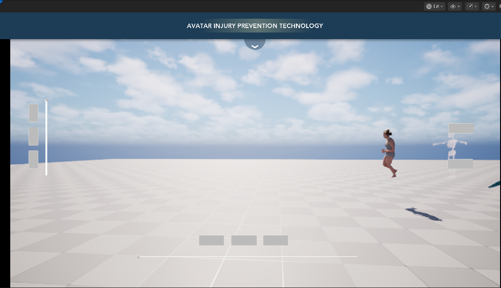 |
| iPad Pro 12.9" – 3 | Menu open: 5 tabs (white circle, blue ▲) | 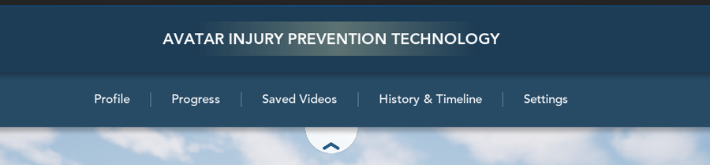 |
| iPad Pro 12.9" – 5 | Analysis panel: viewer, Component 3, videos row | 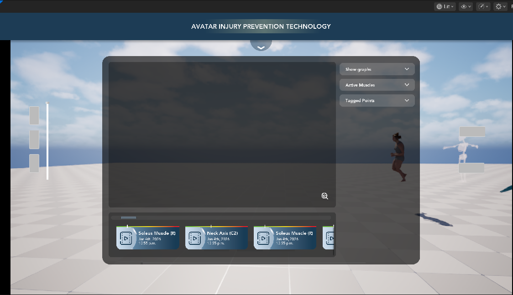 |

**Step 2 (added later):** the playback / timeline bar from the Figma layer **`ihpc ui (1)ee 1`** on frame 1 — record,
restart, pause, slow down, speed up, play, fast-forward, bookmark and the timeline itself — replacing the project's
prototype timeline. See [Timeline / playback bar](#timeline--playback-bar-wbp_ihpc_timeline) below.
**Step 3 (added later):** the layer switcher / opacity buttons from the Figma layers **`ihpc ui rttd 2`** and
**`Rectangle 24`** on frame 1 — Body, Muscles, Skeleton — replacing the top-left placeholder and keeping its
functionality. See [Layer switcher](#layer-switcher--opacity-buttons-wbp_ihpc_layerswitcher) below.

## Behaviour

### Title bar + menu (`WBP_IHPC_HUD`)
* **Round arrow** under the title bar opens / closes the nav bar.
  * Closed: see-through navy circle `#1D3C55 @ 44%` with a white ▼.
  * Open: white circle `@ 86%` with a blue `#245983` ▲, moved down to sit under the nav bar.
* **Tabs** (Profile, Progress, Saved Videos, History & Timeline, Settings):
  * Hover or selected → Figma *Variant2*: bold, green `#B3CA7F`, 1.2× bigger.
  * Click a tab to select it, click again to unselect.
  * **Saved Videos** opens the analysis panel and closes the nav bar (exactly like frame 5).
  * **Profile, Progress, History & Timeline, Settings** *(step 4)* each open their own **empty panel** with the same look
    as the analysis panel's background — Figma frame 5 **"Rectangle 26"** (black 62 %, radius 29, 1217 × 798, same
    place). Their content is not designed yet; each panel has an empty area (`…Content`) to build it in.
  * Opening any panel closes the nav bar (it would cover the top of the panel).
* **Close "X"** *(step 4)* on the top-right corner of whichever panel is open: closes the panel and unselects the tab
  (clicking the selected tab again still works too). Not in Figma, so it uses the HUD's own style: a navy `#1D3C55`
  circle with a thin white rim and a white rounded-stroke X (same stroke style as the menu arrow); hover = nav-bar blue
  `#274A65`.

| Saved Videos with the X | Profile (empty "Rectangle 26" panel) |
|---|---|
| 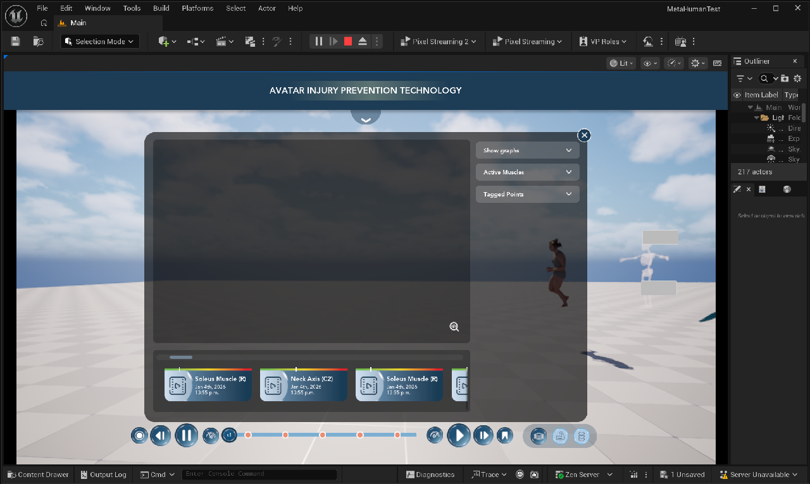 | 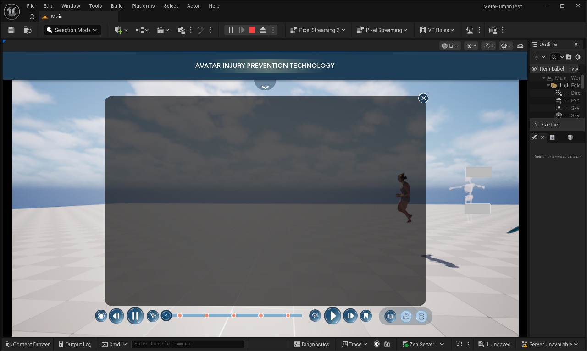 |

* Clicks on empty parts of the screen still reach the 3D view, so orbit / pan / zoom keep working.

### Analysis panel (`WBP_IHPC_AnalysisPanel`)
* Big dark rounded panel (`rgba(0,0,0,0.62)`, radius 29) with a viewer area, Component 3 on the right and the videos row
  at the bottom.
* **Inspect** button (magnifier with `</>` in the viewer corner): closes the big graph if it is open; otherwise fires
  `OnInspectClicked` for a future 3D close-up.

### Component 3 — graph accordion (`WBP_IHPC_GraphAccordion`)

| Closed (Figma Default) | Show graphs open (Figma Variant2) | Bones only | Tagged Points |
|---|---|---|---|
| (headers only) | 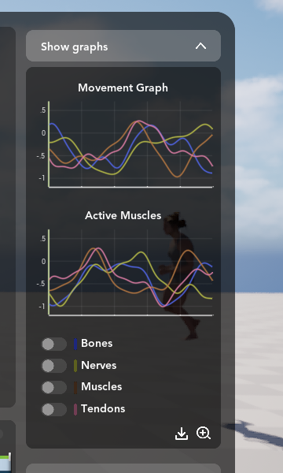 | 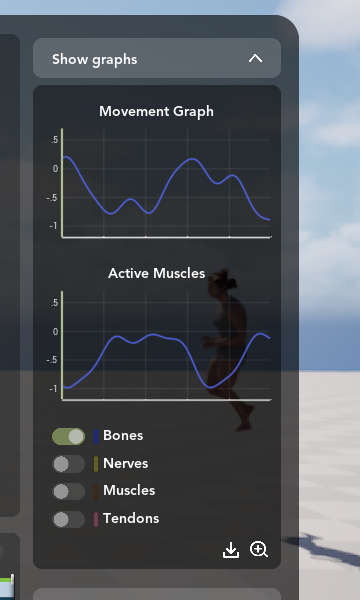 | 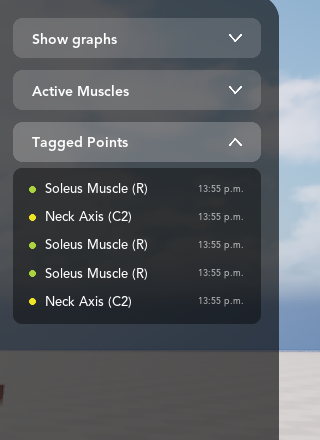 |

* Click a header to open its section; only **one section is open at a time**.
* **Show graphs**: two **live** line graphs (Movement Graph, Active Muscles) drawn from numbers, not pictures.
  * A green **playhead** line follows the avatar animation timeline.
  * **Switches**: with none on, every line shows (this is what Figma draws). Turn some on to show only those lines.
  * **Download** writes both graphs to `Saved/IHPC_Exports/IHPC_Graphs_<date>_<time>.csv`
    (hover the icon afterwards to see the full path).
  * **Zoom** shows a big Movement Graph in the viewer area:

    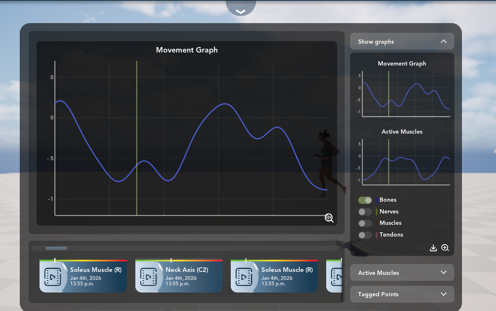
* **Active Muscles**: a list of muscles (sample names from the level's Muscles folder until real data is connected).
* **Tagged Points**: the same moments as the video cards; the dot colour = severity; clicking a row jumps the animation.

### Videos row (`WBP_IHPC_VideosRow` + `WBP_IHPC_VideoCard`)
* Five sample cards from Figma ("Soleus Muscle (R)", "Neck Axis (C2)", "Jan 4th, 2026", "13:55 p.m.").
* Each card's text comes from data; the **white tick** on the green→red bar is the severity (0 = left, 1 = right).
* Scroll with the mouse wheel or drag the thin light-blue indicator above the cards.
* **Click a card** → it gets a green outline and the avatar animation jumps to that moment (the playhead on the graphs
  moves there too):

  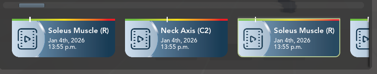

### Component 4 — toggle switch (`WBP_IHPC_ToggleSwitch`)
Grey track + knob left (off) / green `#B3CA7F` track + knob right (on), exactly the two Figma variants.

### Timeline / playback bar (`WBP_IHPC_Timeline`)

| Figma (`ihpc ui (1)ee 1` + the `x1.5` text) | Unreal |
|---|---|
| 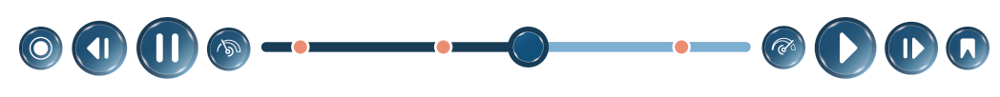 | 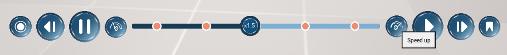 |

At the bottom centre of the screen (inside the HUD, behind the analysis panel). Left to right:

| Button | What it does |
|---|---|
| **Record** (ring) | 1st click: start recording (also starts playback); the button turns red and a red dot pulses. 2nd click: stop → a new clip **"Recording N"** (date/time = when you started, position = where you started) appears as a **new card in Saved Videos**, a new **Tagged Point** and a new **marker** on the track. |
| **Restart** (◀\|) | Jump to the start; keeps playing if it was playing. |
| **Pause** | Pause the avatar animation. |
| **Slow down** (low speedometer) | One step slower: 3× → 2× → 1.5× → 1× → 0.5× → 0.25×. |
| **Timeline** | Dark part = already played, light part = still to play. **Drag or click** to scrub (playback pauses while you drag and resumes after). The knob shows the speed (**x1.5** in Figma). **Orange markers** = saved videos, recordings and bookmarks; **click a marker** to jump there; hover it to see its name. |
| **Speed up** (high speedometer) | One step faster. |
| **Play** | Play forward (from the start again if it is at the end). |
| **Fast-forward** (\|▶) | Jump to the **next marker** after the current time (or to the end if there is none). |
| **Bookmark** | Drop a marker at the current time; it is added to **Tagged Points** as "Bookmark N". |

| Recording (button red, dot pulsing) | New recordings in Saved Videos | Bookmark + recording in Tagged Points |
|---|---|---|
| 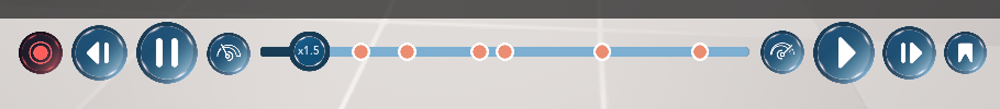 | 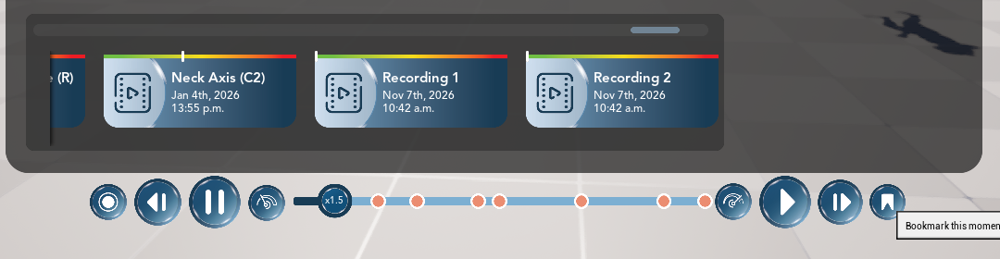 | 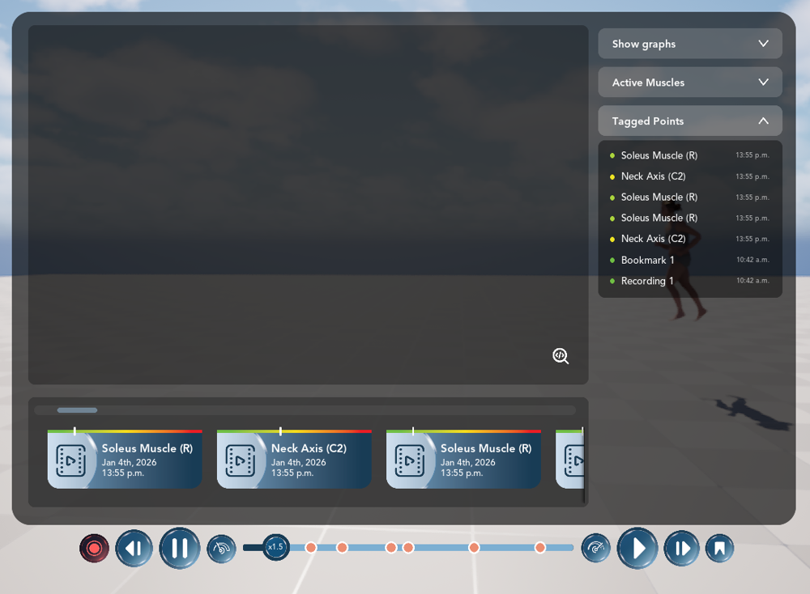 |

The old prototype timeline (`WB_AmationTimeline`: three grey buttons + a slider) is **no longer created** — its slot in
`BP_PlayerController` (*Timeline Widget Class*) was cleared. The asset and its C++ (`WCPP_AnimationTimeline`) are still in
the project if you want them back ([05](05_How_To_Change_Things.md)).

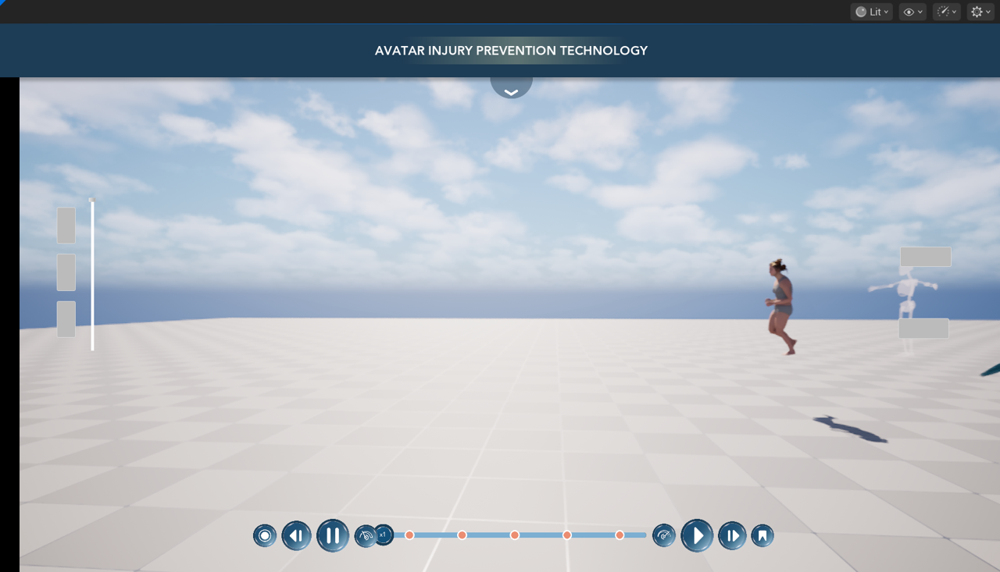

### Layer switcher / opacity buttons (`WBP_IHPC_LayerSwitcher`)

| Figma (`ihpc ui rttd 2` + `Rectangle 24`) | Unreal |
|---|---|
|  | 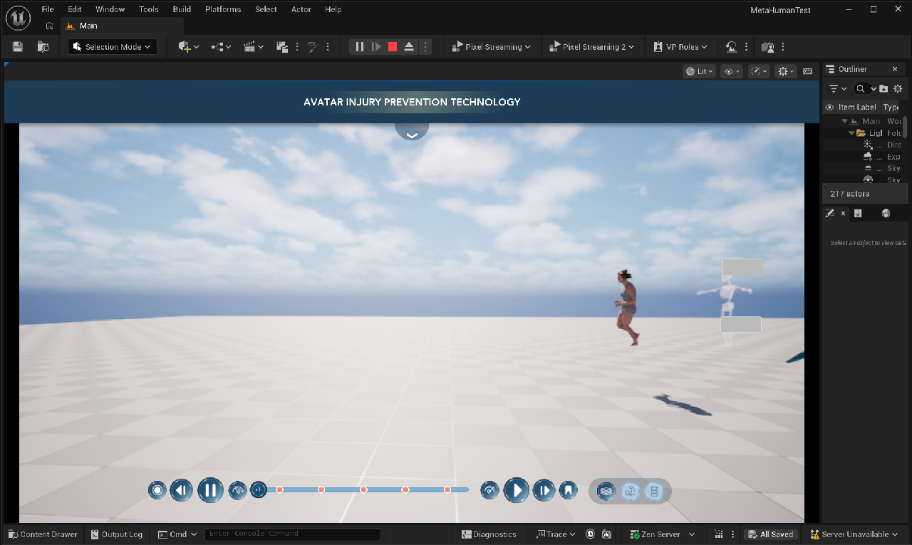 |

Bottom right, beside the timeline (the same place as Figma frame 1). It **replaces the top-left placeholder**
`WB_AnatomyViewSwitcher` (MetaHuman / Muscle / Skeleton buttons + a vertical slider). The opacity *layers* themselves
(the muscle mesh, swapping body → skeleton → muscles) are being built by another team member; this step is the **UI** and
it keeps everything the placeholder did:

| Button | What it does now |
|---|---|
| **Body** (layers icon) | Selected at the start (Figma frame 1). Sets the avatar's **Fade to 1** — body fully visible, hair back to strands. |
| **Muscles** | Sets **Fade to 0.5** (body half see-through). The placeholder's Muscle button did nothing yet, so this is a stand-in until the muscle layer exists. |
| **Skeleton** | Sets **Fade to 0.2** — exactly what the placeholder's button did: body faded, skeleton lined up with the body and visible, hair switches to cards. |

The clicked button turns **dark navy with a white icon** (selected); the others are **light blue with a navy icon**.
Hovering brightens a button, pressing darkens it (like the timeline buttons). The small orange badge Figma shows on
the Skeleton button is **hidden** (team decision); tick *Show Skeleton Badge* in the widget's Class Defaults to bring it back.

Tested in Play — left to right: **Skeleton** (0.2), **Muscles** (0.5), **Body** (1.0):

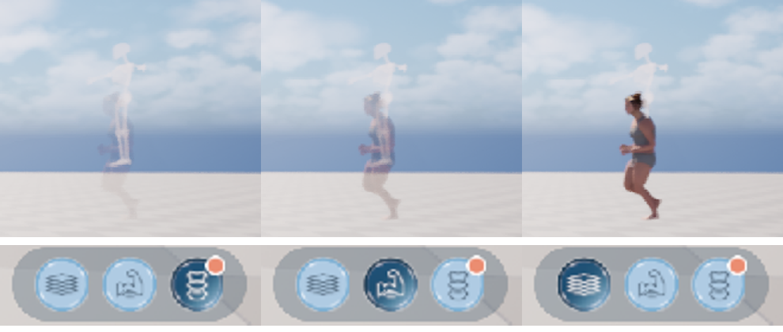

**How it keeps the placeholder's behaviour:** the new widget's C++ class is a *child* of the teammate's
`CPP_UW_AnatomyViewSwitcher`, so the placeholder's code runs unchanged (finding the parts tagged `WholePart`,
`SkeletonPart`, `FacePart`, `HairPart`, lining up the skeleton, setting the **Fade** material parameter, strands ↔ cards).
The new buttons move the parent's slider (hidden in the new widget), which is exactly what dragging the placeholder
slider did. Nothing in the teammate's files was changed. When the real layers are ready they can change each button's
Fade value or listen to **On Layer Changed** ([05](05_How_To_Change_Things.md)).

To fit both bars at the bottom like Figma, the timeline now sits **125 px left of centre** (its Figma position).

## Connection to the existing project
* Clicking a card, tagged point or marker, and every timeline button, use the project's existing
  **`UAnimationTimelineComp`** on the player's pawn (`PlayForward`, `Pause`, `SetNormalizedTime`, `PlaySpeed`) — the same
  component the old prototype timeline used.
* The HUD is created by **`CPP_PlayerController`** like the project's other widgets: new `MainHUDWidgetClass` (set to
  `WBP_IHPC_HUD` in `BP_PlayerController`), `MainHUDZOrder` (10) and `GetMainHUD()`; the Level Blueprint of `Main` no
  longer creates any UI (it did during step 1). **`BP_PlayerController`** no longer creates `WB_AmationTimeline`.
  `MetaHumanTest.Build.cs` lists `UMG`, `Slate`, `SlateCore` (needed by the new code).
* **`BP_PlayerController`** → *Anatomy View Switcher Widget Class* is now `WBP_IHPC_LayerSwitcher` (was the placeholder
  `WB_AnatomyViewSwitcher`, which is still in `/Game/Widget`). `CPP_PlayerController` creates it exactly as before.
