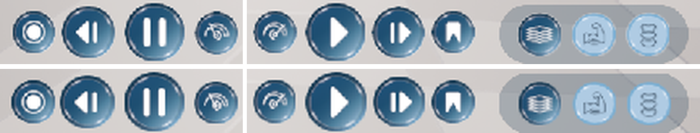

# 06 — Pipeline and tools

How the Figma design became working Unreal UI, step by step, so it can be repeated.

## 1. Read the design
Using the Figma MCP connection (`get_metadata`, `get_design_context`, `get_screenshot`) on
`IImR794aBnUhWDt891b1wQ`, page *Default iPad Version*:
* the 8 requested components (node ids in [02](02_Figma_To_Unreal_Map.md)),
* iPad frames 1, 3 and 5 for how they fit together.
Screenshots of those frames are in `SourceArt/Figma/Screens/`.

## 2. Download the assets → `SourceArt/Figma/Original/`
SVGs (toggle states, chevrons, zoom, header circle/arrow, tab separator) and PNGs (download icon, inspect icon,
video-card art, chart picture).

## 3. Make Unreal-ready textures → `SourceArt/Figma/UE/`
```
python -I Tools/FigmaUI/make_ui_textures.py
```
[`Tools/FigmaUI/make_ui_textures.py`](../Tools/FigmaUI/make_ui_textures.py):
* rasterises each SVG from its exact numbers at 4× (Unreal cannot import SVG), with round caps/joins like the SVG;
* resizes the two PNG icons;
* builds the title-glow gradient and the bar drop-shadow from the Figma CSS values;
* rebuilds the **video card** without text: the Figma card picture has the text baked in, but every text-free row of the
  card body is identical, so one clean row is copied down the body; the white severity tick is removed by borrowing the
  pixels from another card where the tick is elsewhere.

## 4. Import into Unreal → `/Game/UserInterface/IHPC/Textures`
[`Tools/FigmaUI/ue_import_textures.py`](../Tools/FigmaUI/ue_import_textures.py) (runs inside Unreal's Python).
Sets UI-appropriate settings on each texture: *UserInterface2D* compression (uncompressed), **mipmaps (Simple Average) +
trilinear filter**, never stream, *UI* texture group, sRGB. (The first import used *no mipmaps*, which made the
timeline icons look pixelated when drawn at a third of their size — fixed later, see below.)
It was run headless while the editor was closed:
```
UnrealEditor-Cmd.exe <project>/MetaHumanTest.uproject -run=pythonscript -script=<project>/Tools/FigmaUI/ue_import_textures.py -unattended -nosplash -nullrhi -SCCProvider=None
```
(With the editor open you can run it from **Tools → Execute Python Script…**.)

## 5. Write the C++ → `Source/MetaHumanTest/*/IHPC_UI`
See [03](03_Code_Walkthrough.md). Built with the editor closed:
```
Build.bat MetaHumanTestEditor Win64 Development -Project=<project>/MetaHumanTest.uproject -WaitMutex
```
Result: *Succeeded*, no warnings in the new files.

## 6. Build the Widget Blueprints → `/Game/UserInterface/IHPC/Widgets`
Built through the Unreal MCP connection (UMG toolset + property tools). The exact script — every widget, size,
colour and font — is kept in [`Tools/FigmaUI/build_widget_blueprints.py`](../Tools/FigmaUI/build_widget_blueprints.py).
Build order: ToggleSwitch, NavTab, VideoCard → VideosRow → GraphAccordion → AnalysisPanel → HUD (each one uses the ones
before it).

## 7. Hook into the game
*Step 1:* the `Main` Level Blueprint's *Create Widget* node was pointed at `WBP_IHPC_HUD` (Z-order 10).
*Later (to keep the project's original organisation):* the HUD moved to **`CPP_PlayerController`** — new
`MainHUDWidgetClass` / `MainHUDZOrder` / `GetMainHUD()`, created in `BeginPlay` with the controller as owner right after
the anatomy and pawn switchers; `BP_PlayerController` → *Main HUD Widget Class* = `WBP_IHPC_HUD`; the Level Blueprint's
Create Widget / Add to Viewport nodes were deleted (Begin Play is empty again).
*Fix:* deleting those nodes left Begin Play's exec wire pointing at the deleted Create Widget node, so `Main` showed a
compiler error (*"Statement tried to pass control flow to a node Create Widget that generates no code"*). The leftover
wire was broken and the level recompiled cleanly.

## 8. Test in Play-In-Editor
Clicked through every control (menu, tabs, accordion, switches, download, zoom, inspect, cards, tagged points) and
compared screenshots with the Figma frames — see the images in [01](01_Overview.md). One bug found and fixed: the selected
card's green outline was invisible because the outline inherited the fill's 0% opacity.

## Step 2 — timeline / playback bar (same pipeline)
1. **Read**: Figma layer `ihpc ui (1)ee 1` (`124:1059`) on frame 1 + the `x1.5` text layer (`153:323`).
2. **Download**: `SourceArt/Figma/Original/timeline_export.png` (1×) and `timeline_raw_1.png` (3× original).
3. **Measure**: each element's box from the 3× picture's alpha channel (see the table in [02](02_Figma_To_Unreal_Map.md)).
4. **Textures**: `make_timeline_assets()` in `make_ui_textures.py` — exact crops of the 8 buttons, a circular crop of the
   knob, and the marker dot drawn from its measured sizes/colour → `T_IHPC_TL_*` (10 textures).
5. **C++**: `CPP_UW_IHPCTimeline` + small additions to the library / accordion / panel / HUD; built with the editor
   closed (*Succeeded*, no new warnings).
6. **Import**: `ue_import_textures.py` (headless) — imports all PNGs; the existing 13 came out unchanged.
7. **Widget Blueprint**: `build_timeline()` in `build_widget_blueprints.py`; `add_timeline_to_hud_and_retire_prototype()`
   put it into the HUD and cleared `BP_PlayerController` → *Timeline Widget Class*.
8. **Test** in Play-In-Editor: every button, scrubbing, markers, and that recordings/bookmarks reach Saved Videos and
   Tagged Points (screenshots in [01](01_Overview.md)).

Two problems found and fixed during step 2:
* **Assets were read-only.** The Git LFS `lockable` attribute (first commit) makes Git set every committed `.uasset/.umap`
  to read-only until it is "locked", so Unreal could not save them. `lockable` was removed from `.gitattributes` and the
  read-only flags cleared. If you ever see "*… as it is read only*" when saving, run
  `attrib -R /S Content\*.uasset` (or untick *Read-only* in the file's Properties).
* **Colours looked too dark.** Colour brushes copied from the default ProgressBar / Slider styles still pointed at the
  engine's grey pictures (`ProgressBar_Background.png`, `Button.png`), which multiplied the colour (~70%). Cleared on the
  timeline track/slider and the videos-row scroll thumb; `brush_patch()` now always clears it.

## Fix — pixelated icons
The timeline button textures are 3× (other icons 4×) their on-screen size so they stay sharp on high-DPI screens. They
were imported with **no mipmaps**, so the GPU had to shrink them 3–4× on the fly, which makes thin lines and glossy rims
jagged. All 23 textures in `/Game/UserInterface/IHPC/Textures` now have **Mip Gen Settings = Simple Average**,
**Filter = Trilinear**, **Never Stream = on** (and `ue_import_textures.py` sets the same on re-import). For crisper but
still smooth icons, try *Mip Gen Settings = Sharpen 1–3* on a texture.

## Step 3 — layer switcher / opacity buttons (same pipeline)
1. **Read**: Figma layers `ihpc ui rttd 2` (`128:1152`) + `Rectangle 24` (`128:1151`) on frame 1, and the same component
   on frame 4 (`129:1203`, Muscles selected). The frames are drawn rotated, so positions were converted to the landscape
   screen (x = 1366 − y, y = x).
2. **Download**: `SourceArt/Figma/Original/layers_f1_*.png` (frame 1), `layers_f4_*.png` (frame 4) — `_raw_1` is the
   4.586× original (853 × 320) — and `layers_pill_rect24.png` (the pill, a plain colour).
3. **Textures**: `make_layer_switcher_assets()` in `make_ui_textures.py`:
   * exact 214 px crops of each circle in both looks (Body/Muscles selected and unselected, Skeleton unselected);
   * the orange badge removed from the skeleton circle by borrowing those rim pixels from another unselected circle (the
     rims are identical), and drawn as its own texture so it can be shown/hidden;
   * **Skeleton selected** (not in Figma) rebuilt: an empty glossy circle made from the two selected circles (where one has
     icon lines the other has clean background; the few overlapping pixels painted over from the gradient), plus the
     skeleton icon in white, its shape read from the unselected picture. Rebuilding *Body selected* the same way matches
     Figma's real one within 0.6 / 255 on average, so the method is faithful.
4. **C++**: `CPP_UW_IHPCLayerSwitcher` (child of the teammate's `CPP_UW_AnatomyViewSwitcher`, which was not changed) +
   `EIHPCAnatomyLayer`. Built with the editor closed: *Succeeded* (the only warnings are the three existing ones in
   `CPP_UW_AnatomyViewSwitcher.cpp`).
5. **Import**: `ue_import_textures.py` (headless) — 7 new `T_IHPC_LS_*` textures. (The import re-saves the existing 23
   textures with identical content; those files were reverted so the commit only contains the new ones.)
6. **Widget Blueprint**: `build_layer_switcher()` in `build_widget_blueprints.py` (copies the hair / spawn defaults from
   the placeholder); `use_layer_switcher_instead_of_placeholder()` points `BP_PlayerController` → *Anatomy View Switcher
   Widget Class* at it and moves the timeline 125 px left (Figma position).
7. **Test** in Play-In-Editor: the placeholder is gone, the switcher sits beside the timeline; Skeleton / Muscles / Body
   each change the highlight and fade the avatar (log shows the teammate's code finding the `WholePart`, `FacePart`,
   `SkeletonPart`, `HairPart` parts); no errors (screenshots in [01](01_Overview.md)).

## Step 4 — close "X" + panels for the other tabs
1. **Read**: Figma frame 5 "Rectangle 26" (`129:1364`) — the panel background already used by the analysis panel
   (`rgba(0,0,0,0.62)`, radius 29, 1217 × 798, 167 from the top, centred).
2. **Texture**: `make_close_icon()` in `make_ui_textures.py` → `T_IHPC_Close.png` (white rounded X; the X is not in Figma).
3. **C++**: `CPP_UW_IHPCHud` — optional `ProfilePanel`, `ProgressPanel`, `HistoryTimelinePanel`, `SettingsPanel`,
   `PanelCloseButton`; `GetPanelForTab`, `RefreshPanels`, `ClosePanel`, `IsAnyPanelOpen`. Built with the editor closed
   (*Succeeded*, only the three existing warnings in `CPP_UW_AnatomyViewSwitcher.cpp`).
4. **Import**: `ue_import_textures.py` (headless); only `T_IHPC_Close` kept (the other re-saves were identical, reverted).
5. **Widget Blueprint**: `add_tab_panels_and_close_button()` in `build_widget_blueprints.py` — 4 Borders with the
   Rectangle 26 brush in the analysis panel's slot (each with an empty `…Content` canvas) + the round X on the panel's
   top-right corner, all inserted before the chevron / nav bar / title bar so those stay on top.
6. **Test** in Play-In-Editor: Saved Videos → X closes it; Profile → empty styled panel with the X → X closes it; the nav
   bar closes when a panel opens (screenshots in [01](01_Overview.md)).
   *Testing note:* the automation clicks the exact centre of a button; the menu arrow's centre lies on the title bar's
   bottom edge, so it had to click the arrow icon (slightly lower) instead. Real clicks on the visible half of the circle
   work normally.

## Fix — rough edges on the timeline and layer buttons
Even with mipmaps the glossy buttons still had slightly ragged edges. Cause: a fully transparent pixel still stores a
colour, and the Figma exports store **white** there (the icons drawn by the script store **black**). Unreal shrinks UI
textures (mipmaps, *Simple Average*) and blends neighbouring pixels (trilinear filtering) **without weighting by
transparency**, so that hidden white leaked into the dark navy edge as a light, uneven rim (and black into the white
chevrons). Fix: `bleed_transparent_edges()` / `bleed_all_outputs()` in `make_ui_textures.py` (run last, on every PNG)
fill each invisible pixel with the colour of the nearest visible edge. Alpha and every visible pixel stay exactly the
same (checked: 0 changed), only the edge blending is clean. All textures re-imported (headless, editor closed).

In Play-In-Editor — top: before, bottom: after (zoomed 4×):



## Git / GitHub
* Repo: <https://github.com/mblumpkin/MetaHumanTest> (private), branch `main`.
* `.uasset`, `.umap`, images and fonts are stored with **Git LFS** (see `.gitattributes`). (They are *not* marked
  lockable any more — see step 2 above.)
* `Binaries/`, `Intermediate/`, `Saved/`, `DerivedDataCache/`, `.vs/`, `*.sln` are ignored (rebuilt automatically).
* Every step above was committed and pushed separately — see [CHANGELOG.md](CHANGELOG.md).

## Perforce (the team's revision control) next to Git
This folder is also `//digitalHumans/main/MetaHumanTestCOPY` in Perforce (workspace `mlumpk3_digitalHumans_DMAE`,
user `mlumpk3` — **without** `@lsu.edu`). Git/GitHub is only a mirror for following the steps.
* [`.p4ignore`](../.p4ignore) keeps the Git folder/files and the Claude/MCP settings out of Perforce, so *Reconcile
  Offline Work* does not try to add `.git/` (6,000+ files).
* Only check out / submit the files that really changed. Checking out the whole folder locks every `.uasset`
  (exclusive `+l`) for teammates, and Unreal's submit check then validates all of them — including old broken
  references that were already in the project (`MI_FirstPersonColorway`, StarterContent `_BuiltData`), which blocks the submit.
* New files must be **marked for add**; Unreal refuses to submit an asset that references one that is not in Perforce
  (e.g. `BP_PlayerController` → `WBP_IHPC_HUD`).
