# 08 — FINAL FESTIVAL redesign (side bar instead of nav bar)

Figma: **"Avatar Injury Prevention Program"**, page **FINAL FESTIVAL** (node `498:2760`), 8 iPad frames (1366 × 1024)
plus the **BOT** component. Reference screenshots: [`SourceArt/Figma/Screens/v2_FinalFestival/`](../SourceArt/Figma/Screens/v2_FinalFestival).

The drop-down nav bar is gone: its tabs are now **round tabs in a side bar** on the left, and each tab opens a **side
panel** that slides in from the left edge. New in this design: the **BOT** assistant chat, the **Action** panel, the
**Graphs** panel (body-region accordion), the **Timeline** panel (tagged points) and the **reset-view** button.

> Pages 01–07 describe the first version (drop-down nav bar, analysis panel). The timeline bar, layer buttons, graphs,
> video cards and toggle switches described there are still used. **Where those pages and this one disagree (HUD layout,
> nav bar, analysis panel), this page is right.**

## See it in 30 seconds

1. Open the project, level **`Main`**, press **Play**.
2. Left edge, top to bottom: **BOT avatar**, the **Skin / Muscles / Skeleton** layer buttons, and the **chevron**.
3. Click the **chevron**. Six tabs appear: **Action** | **Pose Estimation**, **Graphs** | **Timeline**, **Saved Videos**,
   **Settings**. Click it again to fold them away.
4. Click a tab. Its panel slides in from the left, the side bar and timeline slide right, and the timeline drops
   **Record** and **Bookmark** to fit (as in Figma). Close the panel with its round **X** or by clicking the tab again.
5. **Action**: click **Running** or **Tennis Forehand**. The avatar plays it and the card gets a green outline.
6. **Graphs**: open **Arms**. Try the **Bones / Nerves / Muscles / Tendons** switches, the **zoom** icon (big graph),
   the **download** icon (CSV) and the **bookmark** icon (adds "Arms bookmark 1" to the Timeline panel and an orange
   marker on the timeline).
7. **Timeline**: click a row. The playhead jumps to that moment.
8. **BOT avatar**: the chat window opens. Type and press **Enter** (or the arrow).
9. Orbit the camera with the mouse. A round **reset** button appears top right and puts the camera back.

## Figma vs Unreal

All Unreal shots are Play-In-Editor at 1440 × 1080, where the UI scale is 1.0, so positions match the Figma frames.

| Figma | Unreal |
|---|---|
| 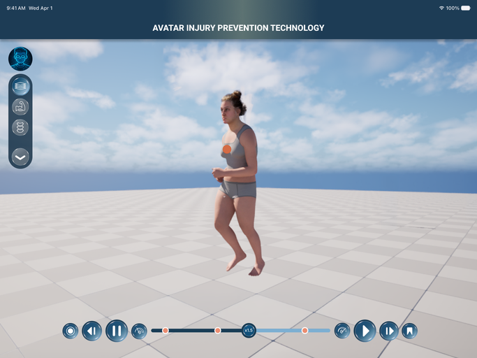 Frame 15: side bar folded | 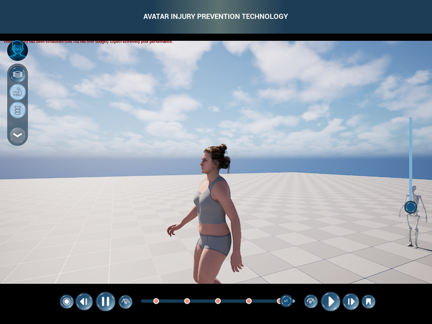 |
| 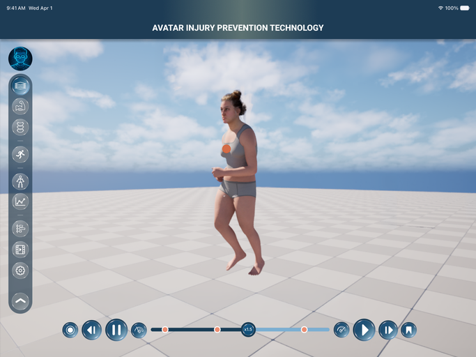 Frame 16: side bar unfolded | 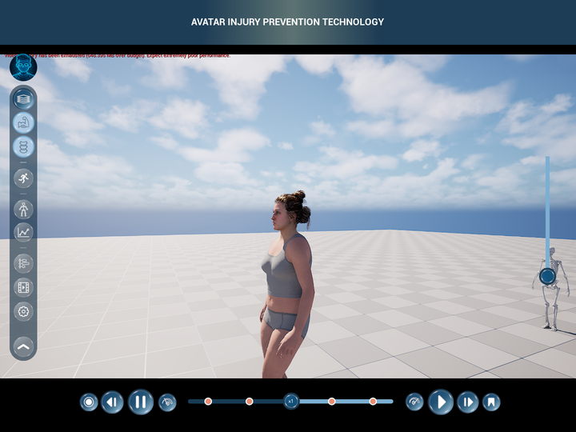 |
| 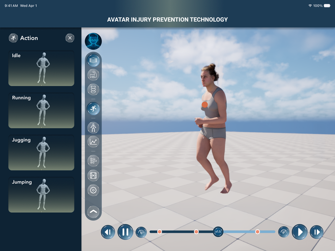 Frame 19: Action panel | 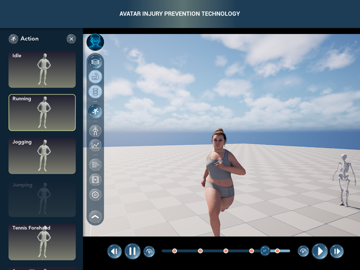 |
| 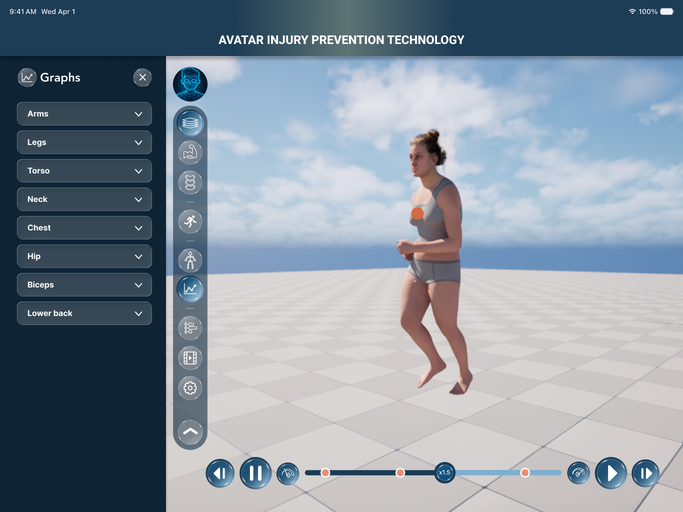 Frame 20: Graphs panel | 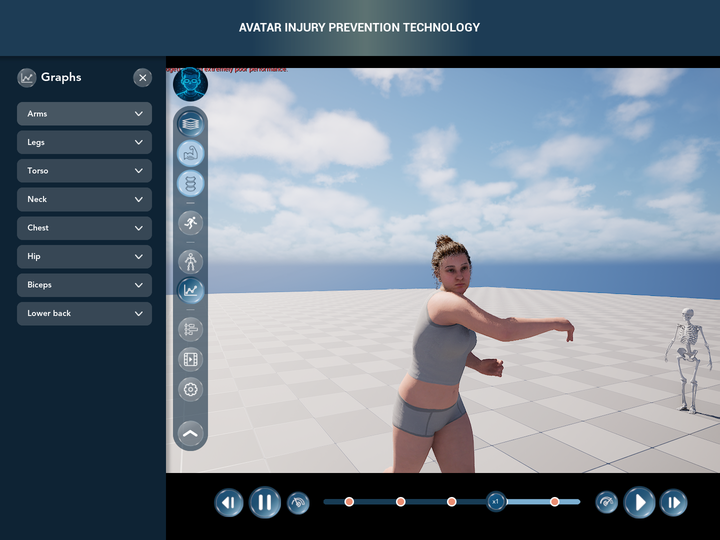 |
| 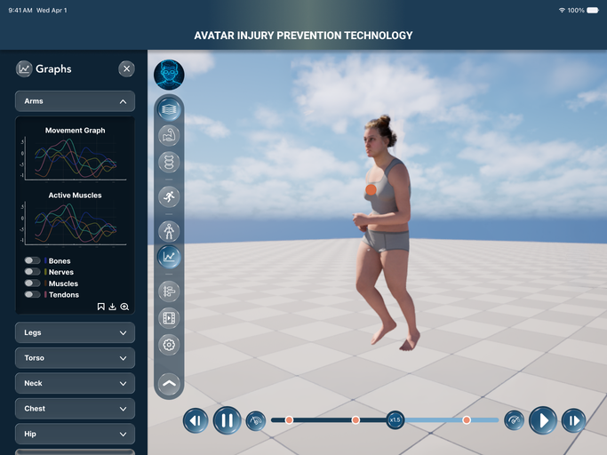 Frame 21: Arms open | 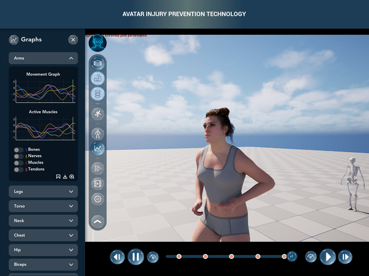 |
| 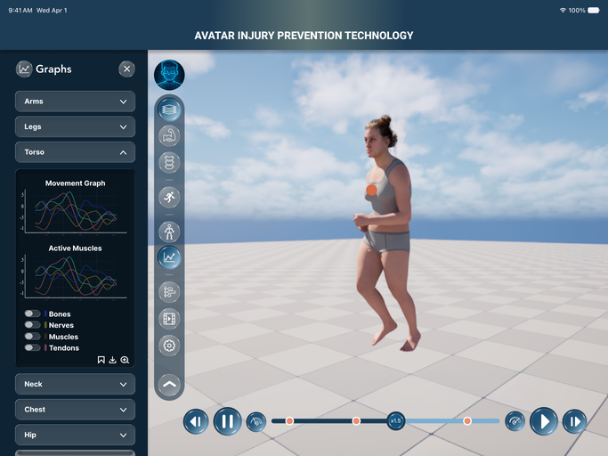 Frame 22: Torso open | 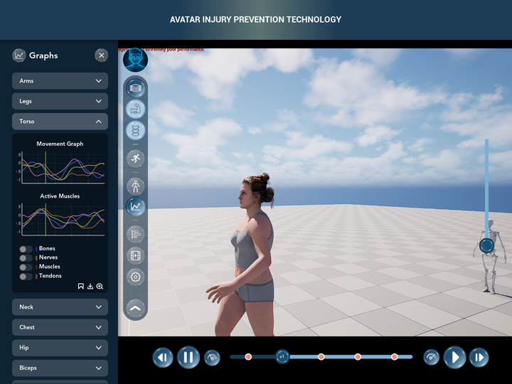 |
| 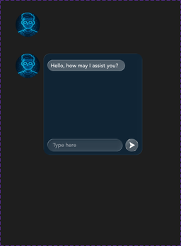 BOT component (Variant2) | 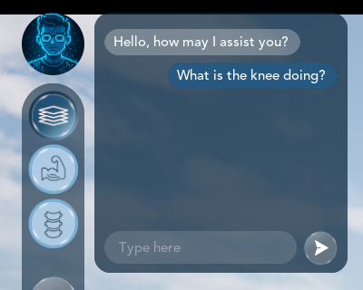 |

Not drawn in Figma, built in the same style:

| Zoomed graph | Timeline panel | Saved Videos panel |
|---|---|---|
| 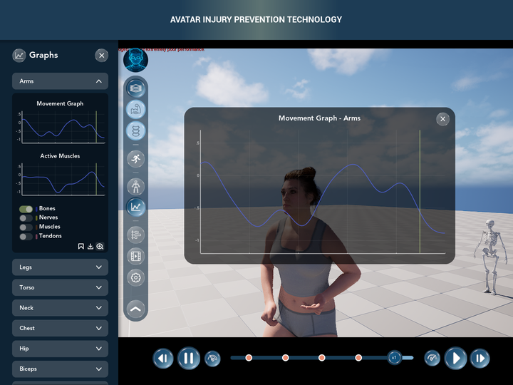 | 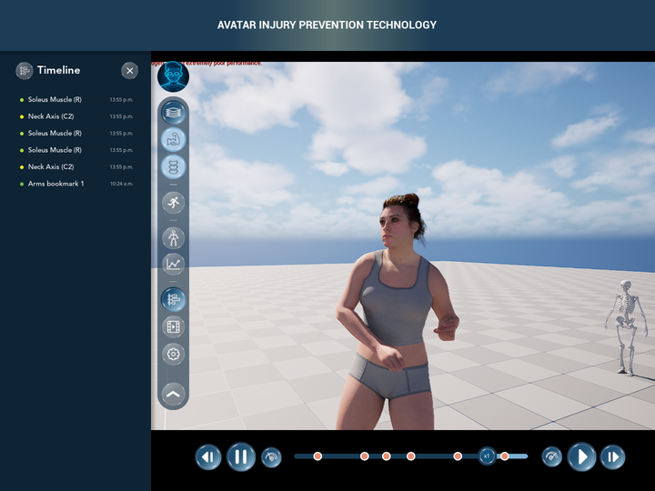 | 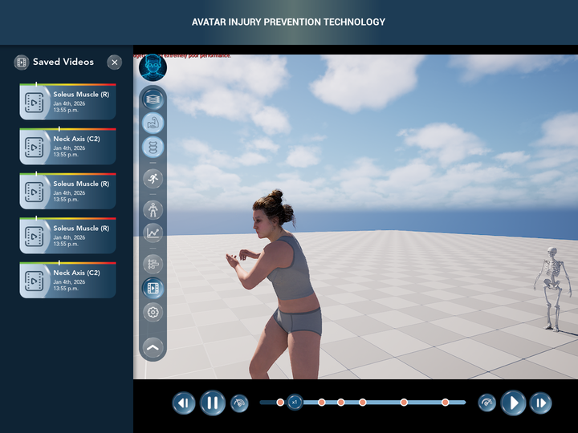 |

| Pose Estimation panel (empty, ready for content) | Tennis Forehand action | Muscles layer |
|---|---|---|
| 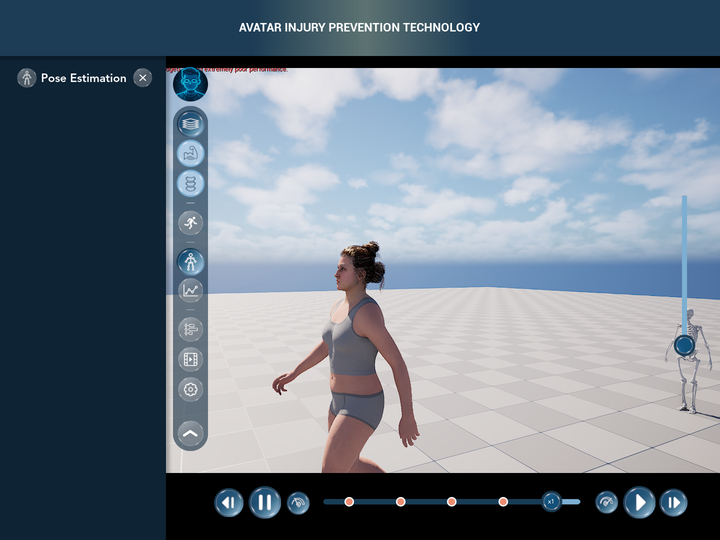 | 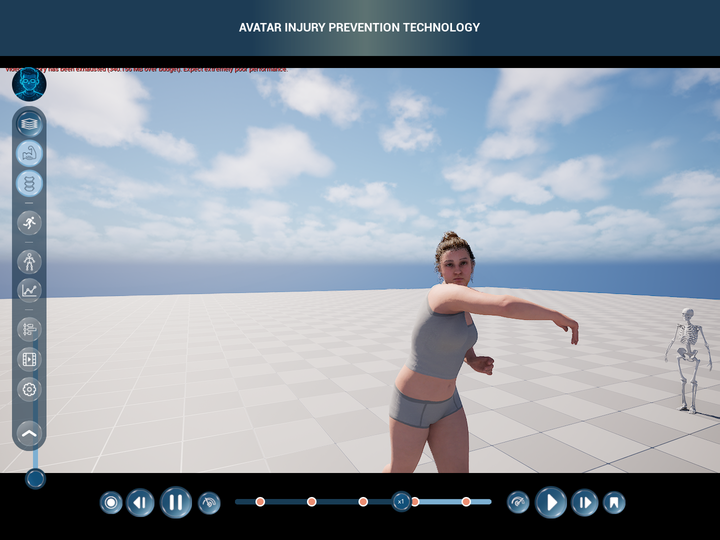 | 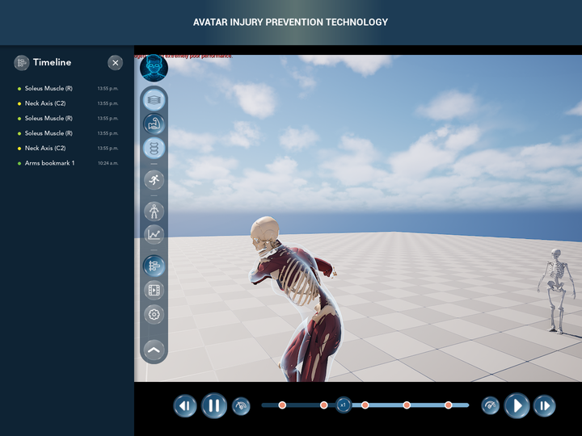 |

*(The red "Video memory has been exhausted" line in some shots is an engine message about the test PC's GPU, not the UI.)*

## Figma → Unreal map

| Figma | Widget Blueprint | C++ class |
|---|---|---|
| Side bar (frames 15/16): avatar, "Rectangle 24" pill, separators "Vector 7", "Group 30" chevron | `WBP_IHPC_SideBar` | `UCPP_UW_IHPCSideBar` |
| One round tab (55 px, frosted / active pictures from `Icons/`) | `WBP_IHPC_SideTab` (×6) | `UCPP_UW_IHPCSideTab` |
| Skin / Muscles / Skeleton buttons | `WBP_IHPC_LayerSwitcher` (now inside the side bar, stacked) | `UCPP_UW_IHPCLayerSwitcher` |
| BOT component, Variant2 (window 279 × 286) | `WBP_IHPC_ChatPanel` | `UCPP_UW_IHPCChatPanel` |
| Side panel "Rectangle 31" (#0E2334, 332 wide) + icon, title, X | `WBP_IHPC_HUD` → `SidePanel` | `UCPP_UW_IHPCHud` |
| Action card (frame 19, 269 × 147, radius 14) | `WBP_IHPC_ActionCard` | `UCPP_UW_IHPCActionCard` |
| Action panel column | `WBP_IHPC_ActionsPanel` | `UCPP_UW_IHPCActionsPanel` |
| Graphs header (270 × 47, white 20 %, radius 11) | `WBP_IHPC_AccordionHeader` | `UCPP_UW_IHPCAccordionHeader` |
| Open section (frames 21/22, 270 × 447, black 41 %) | `WBP_IHPC_GraphCard` | `UCPP_UW_IHPCGraphCard` |
| Graphs panel column (Arms … Lower back) | `WBP_IHPC_GraphsPanel` | `UCPP_UW_IHPCGraphsPanel` |
| Timeline panel (not drawn in Figma) | `WBP_IHPC_TaggedPointsList` | `UCPP_UW_IHPCTaggedPointsList` |
| Saved Videos panel (the old video cards, vertical) | `WBP_IHPC_SavedVideosList` | `UCPP_UW_IHPCVideosRow` |
| Reset view (frame 17: 68 px navy circle) | `WBP_IHPC_HUD` → `ResetViewButton` | `UCPP_UW_IHPCHud` + `UCPP_MouseFunctionComp::ResetView` |
| Title bar (112 tall, Roboto ExtraBold 24 px) | `WBP_IHPC_HUD` → `TitleBar` | — |
| Timeline bar 916 px wide while a panel is open | `WBP_IHPC_Timeline` | `UCPP_UW_IHPCTimeline::SetCompact` |

Fonts: Figma Inter → **Avenir** (already in the project); Roboto ExtraBold → the engine's **Roboto Bold**.
Unreal font size = Figma px × 0.75.

## Widget trees

Names marked **(C++)** are bound by the C++ parent class: restyle, move or wrap them, but don't rename or delete them.

### WBP_IHPC_HUD (parent `CPP_UW_IHPCHud`), new layout
```
HudCanvas (click-through)
├─ Timeline (C++)                WBP_IHPC_Timeline, bottom centre, 26 px above the edge, 1048×102
├─ ZoomedGraphPanel (C++)        Border 760×440, centred, black 62 %, radius 29 — shown by the graph card's zoom icon
│  └─ ZoomedGraphCanvas
│     ├─ ZoomedGraphTitle (C++)  "Movement Graph - <region>"
│     ├─ ZoomedGraph (C++)       CPP_UW_IHPCLineGraph 712×362 (same lines and playhead as the small graph)
│     └─ ZoomedGraphCloseButton (C++) └─ ZoomedGraphCloseX
├─ ResetViewButton (C++)         68 px navy circle, 24 px from the right, top 134 — only after the camera moved
│  └─ ResetViewIcon
├─ SidePanel (C++)               Canvas under the title bar, 360 wide; slides in from the left
│  ├─ SidePanelShadow            T_IHPC_DropShadowRight at x 332
│  ├─ SidePanelBackground        #0E2334, 332 wide
│  ├─ PanelIcon (C++)            the open tab's picture, 43 px at (32, 22)
│  ├─ PanelTitleFit              Scale Box, shrink only, 176 wide at (82, 26)
│  │  └─ PanelTitle (C++)        Avenir Heavy 24 px — the tab's Label
│  ├─ PanelCloseButton (C++)     42 px round button at (264, 22) └─ PanelCloseX
│  ├─ ActionsPanel (C++)             WBP_IHPC_ActionsPanel     ┐
│  ├─ PoseEstimationContent (C++)    empty Canvas Panel        │ all at x 34, 270 wide, from y 92 to the bottom;
│  ├─ GraphsPanel (C++)              WBP_IHPC_GraphsPanel      │ only the open tab's content is visible
│  ├─ TaggedPointsList (C++)         WBP_IHPC_TaggedPointsList │
│  ├─ SavedVideosList (C++)          WBP_IHPC_SavedVideosList  │
│  └─ SettingsContent (C++)          empty Canvas Panel        ┘
├─ SideBar (C++)                 WBP_IHPC_SideBar at (24, 134), auto size
└─ TitleBar                      112 tall: #1D3C55, glow T_IHPC_TitleGlow 576×112, title Roboto Bold
```
Class Defaults: `RoundButtonTexture` = `T_IHPC_SB_Button`. Other settings (C++ defaults): `StartTab` (None),
`SidePanelWidth` 332, `SideBarShiftWhenPanelOpen` 322, `ContentShiftWhenPanelOpen` 177, `bCompactTimelineWhenPanelOpen`,
`bCloseActionsPanelOnSelect` (off), `bShowResetViewOnlyWhenMoved`, `ResetViewColor`, `GraphBookmarkTitleFormat`.

### WBP_IHPC_SideBar (parent `CPP_UW_IHPCSideBar`)
```
SideBarRoot (Canvas, click-through)
├─ BotButton (C++)               69×69 at (0, 0), picture = BotTexture (T_IHPC_Bot)
├─ ChatPanel (C++)               WBP_IHPC_ChatPanel 279×286 at (80, 0), hidden until BOT is clicked
└─ Pill                          rgba(12,39,61,0.59), fully round, at (0, 78), grows with its content
   └─ PillStack (Vertical Box)
      ├─ LayerSwitcher (C++)     WBP_IHPC_LayerSwitcher — Skin / Muscles / Skeleton, 55 px, about 4 px apart
      ├─ ExtraTabs (C++)         Vertical Box, folded away until the chevron is clicked
      │  ├─ Separator_1, Tab_Actions (C++)
      │  ├─ Separator_2, Tab_PoseEstimation (C++), Tab_Graphs (C++)
      │  └─ Separator_3, Tab_Timeline (C++), Tab_SavedVideos (C++), Tab_Settings (C++)
      └─ ExpandButton (C++)      57 px frosted circle (ExpandButtonTexture)
         └─ ExpandIcon (C++)     chevron: ExpandTexture (down) / CollapseTexture (up)
```
Each `Tab_*` is a `WBP_IHPC_SideTab`; its **TabId**, **Label** (the panel title), **NormalTexture**
(`T_IHPC_SB_<Name>`) and **ActiveTexture** (`T_IHPC_SB_<Name>_Active`) are set on the instance in this tree.

### The panel contents
```
WBP_IHPC_ChatPanel        ChatSize 279×286 └─ ChatBackground rgba(12,39,61,0.72) r18 └─ ChatCanvas
                          ├─ MessageList (C++)   Scroll Box (11,18) 257×213 — C++ adds the bubbles
                          ├─ InputBackground     white 13 %, round, (11,241) 212×35 └─ MessageInput (C++) "Type here"
                          └─ SendButton (C++)    40 px frosted circle (229,239) └─ SendIcon
WBP_IHPC_ActionsPanel     PanelSize 270 └─ CardList (C++) Scroll Box — one WBP_IHPC_ActionCard per action (CardClass), 25 apart
WBP_IHPC_ActionCard       CardSize 269×147 └─ CardOverlay
                          ├─ CardPicture (C++)        T_IHPC_ActionCard (mannequin, gradient, rounded corners)
                          ├─ CardLabel (C++)          Avenir Heavy 20 px
                          ├─ SelectionHighlight (C++) green #B3CA7F outline = this action is playing
                          └─ CardButton (C++)         invisible button over the card
WBP_IHPC_GraphsPanel      PanelSize 270 └─ RegionScroll └─ RegionList (C++)
                          headers (HeaderClass = WBP_IHPC_AccordionHeader) + GraphCard (C++), moved under the open region
WBP_IHPC_AccordionHeader  HeaderSize 270×47 └─ HeaderButton (C++) white 20 % r11
                          └─ HeaderContent: HeaderLabel (C++), HeaderChevron (C++) (T_IHPC_AccChevron_Down / _Up)
WBP_IHPC_GraphCard        CardSize 270×447, black 41 % r11 └─ CardCanvas
                          ├─ MovementGraphTitle, MovementGraph (C++)          CPP_UW_IHPCLineGraph 258×106
                          ├─ ActiveMusclesTitle, ActiveMusclesGraph (C++)
                          ├─ Toggle_Bones / _Nerves / _Muscles / _Tendons (C++)  WBP_IHPC_ToggleSwitch + legend bar + label
                          └─ BookmarkButton (C++), DownloadButton (C++), ZoomButton (C++)
WBP_IHPC_TaggedPointsList ListSize 270 └─ ListOverlay ├─ PointsScroll └─ PointsList (C++)
                                                      └─ EmptyText (C++, optional) "No tagged points yet…"
WBP_IHPC_SavedVideosList  ListSize 270 └─ CardScrollBox (C++) — WBP_IHPC_VideoCard per saved video (CardClass), 16 apart
```

## What each part does (C++)

| Class | Behaviour | Handy for Blueprints |
|---|---|---|
| `UCPP_UW_IHPCHud` | Owns the side panel: shows the open tab's content, slides the panel in/out (`PanelSlideTime`) and moves the side bar and timeline with it, compact timeline, zoomed graph, reset view, wires bookmarks / recordings into the Timeline panel and timeline markers. | `SelectSideTab`, `ToggleSideTab`, `ClosePanel`, `IsAnyPanelOpen`, `SetSideBarExpanded`, `SelectAction`, `AddSavedVideo`, `AddTaggedPoint`, `ResetView`, `GetChatPanel`; events `OnSideTabChanged`, `OnActionChanged`, `OnChatMessageSent` |
| `UCPP_UW_IHPCSideBar` | BOT toggles the chat; chevron folds / unfolds the extra tabs (and swaps the chevron picture); tells the HUD which tab was clicked; shows the selected tab. | `SetExpanded`, `SetChatOpen`, `GetTab`, `GetLayerSwitcher`; `bStartExpanded`, `bStartChatOpen` |
| `UCPP_UW_IHPCSideTab` | Round picture button: `NormalTexture`, or `ActiveTexture` while its panel is open; hover ×1.15, pressed ×0.8. | `SetSelected`; event `OnTabClicked` |
| `UCPP_UW_IHPCChatPanel` | Bubbles (BOT left, user right, wrap at `MaxBubbleWidth`), greeting, Enter / arrow sends. **No assistant is connected yet.** | `AddBotMessage`, `AddUserMessage`, `ClearMessages`; event `OnMessageSent`; `PlaceholderReply` |
| `UCPP_UW_IHPCActionsPanel` | Builds one card per entry in `Actions`. A click plays the pawn's `UAnimationTimelineComp` action clip (`ActionClips[ActionName]`); a second click on the playing card goes back to Idle. With no clip, Running / Jogging fall back to the pawn's own locomotion speed (1.0 / 0.62). Cards with neither are greyed out. Rebuilt when the controller possesses another pawn. | `SelectAction`, `SetActions`, `RefreshCards`; event `OnActionSelected` |
| `UCPP_UW_IHPCGraphsPanel` | One header per `Regions` entry (Arms, Legs, Torso, Neck, Chest, Hip, Biceps, Lower back). One region open at a time, with the graph card under it. | `OpenRegion`, `ToggleRegion`; event `OnRegionChanged` |
| `UCPP_UW_IHPCGraphCard` | Two line graphs (new demo data per region unless real data was set), filter switches, CSV export, zoom, bookmark. | `SetRegion`, `ExportGraphsToCSV`, `GetMovementGraph`; events `OnZoomRequested`, `OnBookmarkRequested` |
| `UCPP_UW_IHPCTaggedPointsList` | Rows of saved videos, recordings and bookmarks. Clicking a row moves the avatar's timeline there (`bSeekTimelineOnClick`). | `SetTaggedPoints`, `AddTaggedPoint`; event `OnTaggedPointClicked` |
| `UCPP_MouseFunctionComp` | Remembers the camera just before the user first moves it; `ResetView` goes back; `IsViewChanged` shows the reset button. | `ResetView`, `IsViewChanged` |

**Old Blueprint calls still compile.** `SelectTab`, `GetSelectedTab`, `SetNavBarOpen`, `ToggleNavBar`, `IsNavBarOpen`,
`SetAnalysisPanelOpen` and `OnTabChanged` remain as thin wrappers: Saved Videos → Saved Videos tab, History & Timeline →
Action tab, Settings → Settings tab, nav bar open → side bar unfolded. Profile and Progress are not in the new design and do
nothing.

## How to change things

* **Add or rename an action card:** `WBP_IHPC_ActionsPanel` → Class Defaults → **Actions**. `ActionName` must match a
  key in the pawn's `AnimationTimelineComp` → **Action Clips**. Give a card its own **Picture** or leave it on
  `DefaultCardPicture`.
* **Make Jumping (or a real Idle) work:** add a clip for the pawn's skeleton to its `AnimationTimelineComp` →
  **Action Clips** with the key `Jumping` (or `Idle`). The card turns on by itself.
* **Connect the chat to an assistant:** bind `WBP_IHPC_HUD` → **On Chat Message Sent** (or the chat panel's
  **On Message Sent**), send the text to your service, then call **Get Chat Panel → Add Bot Message** with the answer.
  For a canned reply meanwhile, set the chat panel's **Placeholder Reply**.
* **Fill the Pose Estimation or Settings panel:** in `WBP_IHPC_HUD`, put your widget inside **`PoseEstimationContent`**
  or **`SettingsContent`**, both empty Canvas Panels 270 wide. The HUD shows and hides them with their tab.
* **Change a tab's icon:** replace the picture in `Icons/` (`<Name>.png` + `Active <Name>.png`, 211 px), run
  `Tools/FigmaUI/make_final_festival_textures.py`, then re-import (see below). Or set the tab's **Normal / Active
  Texture** on its instance in `WBP_IHPC_SideBar`.
* **Open a panel at start:** `WBP_IHPC_HUD` → Class Defaults → **Start Tab**. Unfold the side bar at start:
  `WBP_IHPC_SideBar` → **Start Expanded**.
* **Keep Record / Bookmark while a panel is open:** HUD → untick **Compact Timeline When Panel Open**.

## Pipeline (how it was built)

1. `Tools/FigmaUI/make_final_festival_textures.py` turns `Icons/` and `SourceArt/Figma/Original/v2_FinalFestival/`
   into `SourceArt/Figma/UE/T_IHPC_*.png`: side bar icons at 211 px, everything drawn at 4× the Figma size, clean edges.
2. 32 textures imported into `/Game/UserInterface/IHPC/Textures` with the UI settings of `ue_import_textures.py`
   (uncompressed, mipmaps, UI group, never stream).
3. `Tools/FigmaUI/build_final_festival_widgets.py` records every Widget Blueprint step and can re-run it through the
   editor's Unreal MCP (*ProgrammaticToolset*), in this order: `build_side_tab`, `build_chat_panel`, `build_action_card`,
   `build_accordion_header`, `build_graph_card`, `build_graphs_panel`, `build_actions_panel`,
   `build_tagged_points_list`, `build_saved_videos_list`, `update_layer_switcher`, `build_side_bar`, `update_hud`,
   `update_player_controller`, then the fixes `fit_panel_title` and `move_speed_slider`.
4. C++ built with the editor closed (`MetaHumanTestEditor Win64 Development`): *Succeeded*, no warnings.

## Tested in Play-In-Editor (2026-11-09)

| Works | |
|---|---|
| Side bar | folds / unfolds, chevron flips; selected tab shows its active picture |
| BOT chat | opens next to the avatar, greeting bubble, Enter sends a right-aligned bubble, closes again |
| Layer buttons | Skin / Muscles / Skeleton switch the avatar (active button dark, the others light, as in frame 17) |
| Panels | all six open, switch, and close with X or their tab; side bar + timeline slide right, timeline goes compact |
| Action | Running (clip), Tennis Forehand (clip, animates, playhead moves), Idle; playing card outlined green |
| Graphs | accordion (Arms, Torso), filter switches, zoom (big graph + X), bookmark → Timeline row + timeline marker |
| Timeline panel | rows listed (saved videos + new bookmark); clicking a row moves the playhead to it |
| Saved Videos | the video cards in a vertical list |

Not tested live: **reset view** (the button appeared after the camera moved, but the click was not tested, because
the automated driver cannot drag in the 3D view), **CSV download** and **Soccer Warmup** (scrolled off the bottom).

## Known limitations and next steps

* **Jumping** is greyed out: no pawn has a `Jumping` action clip. The project only has the UE mannequin's `MM_Jump`;
  retarget it to the MetaHuman skeletons (as was done for `AS_Running_MH`) and add it to **Action Clips**.
* **Idle** has no clip either, so it plays the pawn's default locomotion (a walk), not a standing idle. Add an `Idle`
  clip for a real idle.
* **Chat** has no assistant behind it yet (see *Connect the chat* above).
* **Pose Estimation** and **Settings** open empty panels, ready for content (pose estimation is planned to come from
  the `MetaHumanTest-PoseEstimation` project).
* **Graphs** show demo data per region until real data is fed in (`GetMovementGraph()->SetSeries…`, see 03/05).
* **Speed slider** (`BP_SpeedSlider`, walk → jog → run) is not in Figma. It sat bottom-left, where the unfolded side
  bar now is, so it moved to the middle of the right edge. Delete `SpeedSliderWidget` in `BP_PlayerController` if the
  Action cards should be the only control.
* **Black bars above and below the 3D view** at 4:3 window sizes come from the pawn's camera, not from the UI:
  `BP_MH_CH_Abby8` → **CineCamera** has *Constrain Aspect Ratio* on, at 16:9. The Figma iPad frames have none; untick
  it to match.
* `WBP_IHPC_AnalysisPanel`, `WBP_IHPC_NavTab`, `WBP_IHPC_GraphAccordion` and `WBP_IHPC_VideosRow` (first version) are
  no longer placed in the HUD. They still compile and are kept for reference, and can be deleted once nothing else uses them.
* While testing with an automated click driver, the first click on **BOT** was sometimes ignored right after the chat
  closed. Every other button responded every time, and the toggle code is one line, so this is most likely the
  driver. Worth a check with a real mouse.
