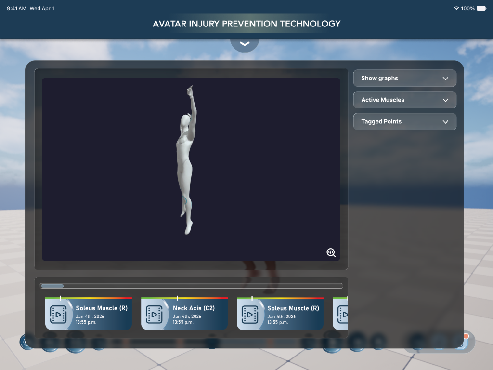
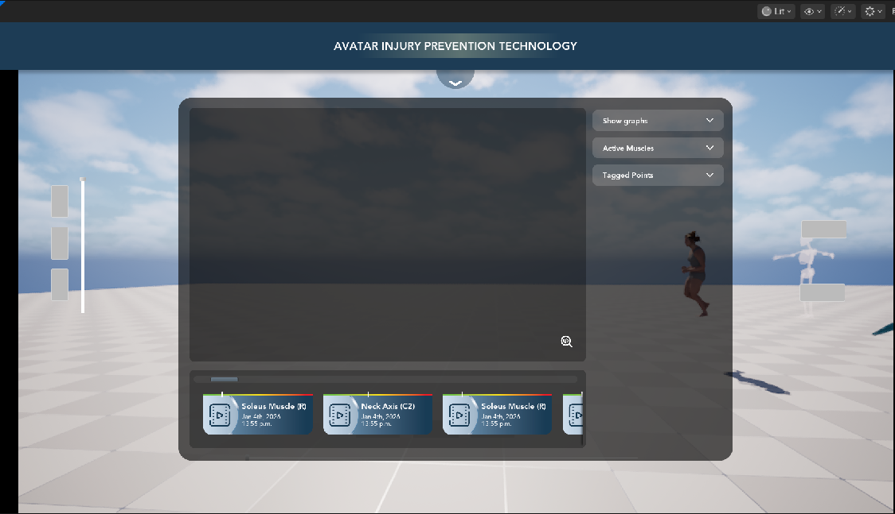

# IHPC UI — Figma to Unreal

This folder explains the user interface that was added to the **MetaHumanTest** Unreal project from the Figma file
**"Avatar Injury Prevention Program"** (page *Default iPad Version*), what every piece does, and how to change it.

| Figma | Unreal (Play-In-Editor) |
|---|---|
|  |  |

## See it in 30 seconds

1. Open the project, open the level **`Main`** (it opens by default).
2. Press **Play**.
3. Click the **round arrow** under the title bar → the nav bar drops down.
4. Click **Saved Videos** → the analysis panel opens.
5. Try: **Show graphs**, the **Bones / Nerves / Muscles / Tendons** switches, the **download** icon (writes a CSV),
   the **zoom** icon (big graph), and click a **video card** (the avatar animation jumps to that moment).
6. **Timeline bar** at the bottom: Play / Pause, slow down / speed up (the knob shows **x1.5** etc.), drag the knob,
   click an orange marker, **Bookmark**, **Record** twice (a new "Recording 1" card appears in Saved Videos),
   **Fast-forward** (jumps marker to marker), **Restart**.
7. **Layer switcher** at the bottom right: **Skeleton** (body fades to 0.2, skeleton shows), **Muscles** (0.5),
   **Body** (fully visible again).
8. Any tab panel closes with the round **X** on its top-right corner; **Profile / Progress / History & Timeline /
   Settings** open empty panels ready for their content.

**To-do lists / step-by-step checklists with links to every function:**
[GitHub issue #1](https://github.com/mblumpkin/MetaHumanTest/issues/1) (step 1: HUD, menu, analysis panel) ·
[GitHub issue #2](https://github.com/mblumpkin/MetaHumanTest/issues/2) (step 2: timeline / playback bar) ·
[GitHub issue #3](https://github.com/mblumpkin/MetaHumanTest/issues/3) (step 3: layer switcher / opacity buttons) ·
[GitHub issue #4](https://github.com/mblumpkin/MetaHumanTest/issues/4) (step 4: close X + panels for the other tabs)

## Pages in this folder

| Page | What it covers |
|---|---|
| [01_Overview.md](01_Overview.md) | What was built, how it behaves, before/after screenshots |
| [02_Figma_To_Unreal_Map.md](02_Figma_To_Unreal_Map.md) | Every Figma component → the Unreal asset and C++ class that implements it, with sizes, colours and fonts |
| [03_Code_Walkthrough.md](03_Code_Walkthrough.md) | Every C++ file and function explained, step by step |
| [04_Widget_Blueprints.md](04_Widget_Blueprints.md) | The widget tree of every Widget Blueprint and which names C++ depends on |
| [05_How_To_Change_Things.md](05_How_To_Change_Things.md) | Recipes: change text/colours, add real data, add a new tab screen, etc. |
| [06_Pipeline_And_Tools.md](06_Pipeline_And_Tools.md) | How the Figma assets became Unreal textures, how to rebuild, the build steps |
| [07_Known_Limitations_And_Next_Steps.md](07_Known_Limitations_And_Next_Steps.md) | What is placeholder data, what was interpreted, what to do next |
| [CHANGELOG.md](CHANGELOG.md) | Every step in order, with its GitHub commit |

## Where everything lives

```
MetaHumanTest/
├─ Source/MetaHumanTest/
│  ├─ Public/IHPC_UI/      ← C++ headers (what each widget exposes)
│  └─ Private/IHPC_UI/     ← C++ code (what each widget does)
├─ Content/UserInterface/IHPC/
│  ├─ Widgets/             ← 9 Widget Blueprints (the look/layout, editable in UMG)
│  └─ Textures/            ← 31 UI textures (icons, toggle, card art, glow, shadow, timeline + layer buttons, close X)
├─ SourceArt/Figma/
│  ├─ Original/            ← files downloaded from Figma
│  ├─ Screens/             ← reference screenshots of the Figma frames
│  └─ UE/                  ← PNGs generated for Unreal
├─ Tools/FigmaUI/          ← scripts: make textures, import textures, record of how the widgets were built
└─ README/                 ← you are here
```

**Who creates the HUD:** `CPP_PlayerController::BeginPlay` creates `WBP_IHPC_HUD` (set as **Main HUD Widget Class** in
`BP_PlayerController` → Class Defaults), the same way it creates the anatomy switcher and pawn switcher, and draws it on
top of them (Z-order 10). The Level Blueprint creates no UI. The **layer switcher** (`WBP_IHPC_LayerSwitcher`, step 3) is
the controller's *Anatomy View Switcher Widget Class*, in place of the old placeholder `WB_AnatomyViewSwitcher`. (The older `WBP_Header` draft is still in
`Content/UserInterface/Widgets` but no longer used.)

## The one idea to understand

Each Figma component is **one C++ class + one Widget Blueprint**:

* the **C++ class** (`CPP_UW_IHPC…`) holds the *behaviour* — what happens on click, where the data comes from;
* the **Widget Blueprint** (`WBP_IHPC…`) holds the *look* — layout, colours, fonts, textures — and can be edited in the
  UMG designer without touching code, **as long as the widget names listed in
  [04_Widget_Blueprints.md](04_Widget_Blueprints.md) stay the same**.

This is the same pattern the project already used (`WCPP_AnimationTimeline` + `WB_AmationTimeline`, etc.).
